<div align="center">


# Chronicles Raid Timer

**A sleek, glassmorphic Windows desktop HUD overlay and Raid Command Center engineered for real-time tracking of world events, multi-phase raids, and custom boss respawn timers.**

<a href="version.py"></a>
<a href="app.py"></a>
<a href="requirements.txt"></a>
<a href="chronicles/ui/hud_overlay.py"></a>
<a href="https://discord.gg/Vthdw8FYt6"></a>
<a href="#license"></a>

<br />

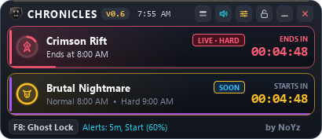

</div>

---

## Overview

**Chronicles Raid Timer (`v0.6`)** is a lightweight, standalone Windows overlay and event command suite built with custom `QPainter` graphics, scalable vector SVG emblems, synthesized HD audio cues, Windows Text-to-Speech announcements, and hook-free anti-cheat-safe global hotkeys.

Whether you want an unobtrusive click-through HUD floating over fullscreen-borderless gameplay or a 24-hour visual timeline to plan multi-phase raids and custom boss respawns, Chronicles Raid Timer delivers precision telemetry in a modern obsidian-glass interface.

---

## Visual Showcase

### Three Adaptive HUD Display Modes

Switch seamlessly between layouts from the HUD toolbar, right-click menu, Command Center, or global hotkey (`F10` by default):

| Tactical Cards *(Detailed)* | Compact Ticker Strip |
| :---: | :---: |
|  | 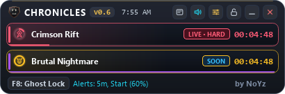 |

**Horizontal Wide Bar** *(ideal for top/bottom monitor edges & ultrawide setups)*:

<div align="center">
  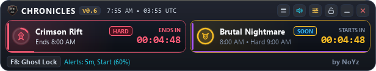
</div>

---

### Six Harmonized Glassmorphic Themes

Every HUD surface, radial ring, badge, border, Command Center panel, and toast alert adapts automatically to the selected theme:

<div align="center">
  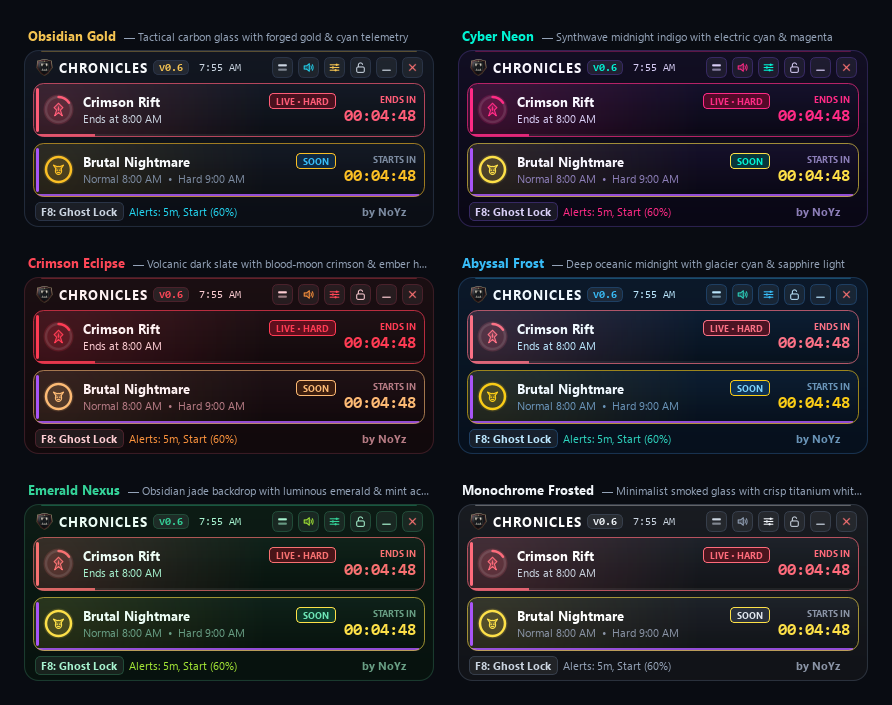
</div>

---

### Chronicles Command Center

A modern, sidebar-navigated 5-tab companion suite for inspecting timelines, managing custom timers, tuning alerts, styling the HUD, and configuring hotkeys:

<details open>
<summary><strong>1. Live 24-Hour Timeline & Upcoming Feed</strong></summary>
<br />
<div align="center">
  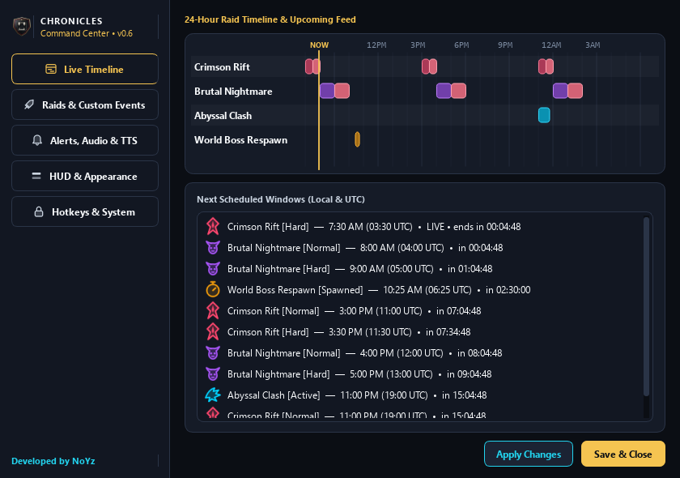
</div>
</details>

<details>
<summary><strong>2. Raids & Custom Event Builder</strong></summary>
<br />
<div align="center">
  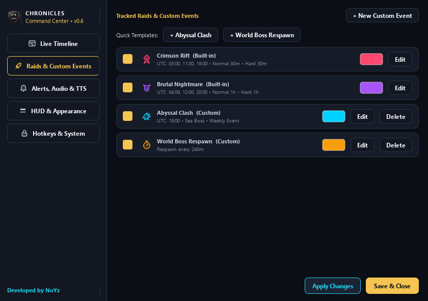
</div>
</details>

<details>
<summary><strong>3. Multi-Stage Alerts, Synthesized Audio & Voice TTS</strong></summary>
<br />
<div align="center">
  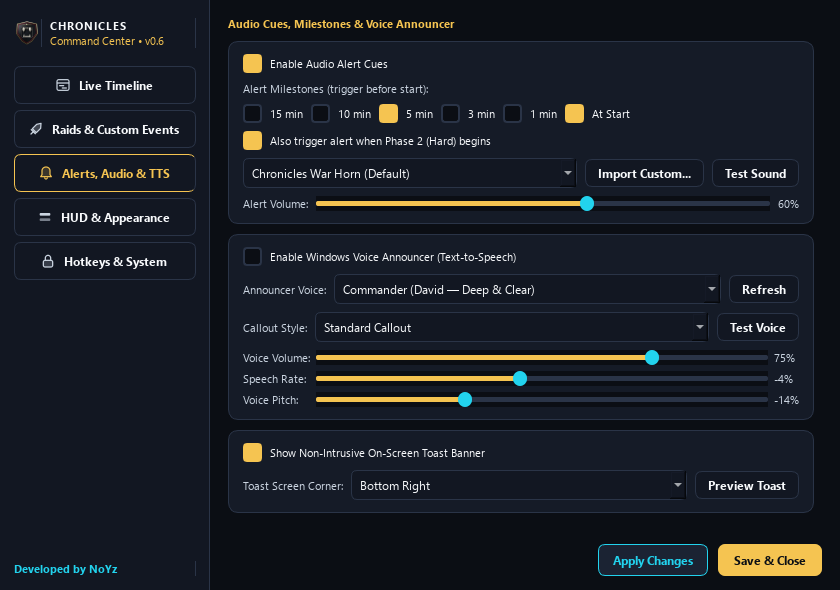
</div>
</details>

<details>
<summary><strong>4. HUD Theme Gallery, Layout & Opacity Controls</strong></summary>
<br />
<div align="center">
  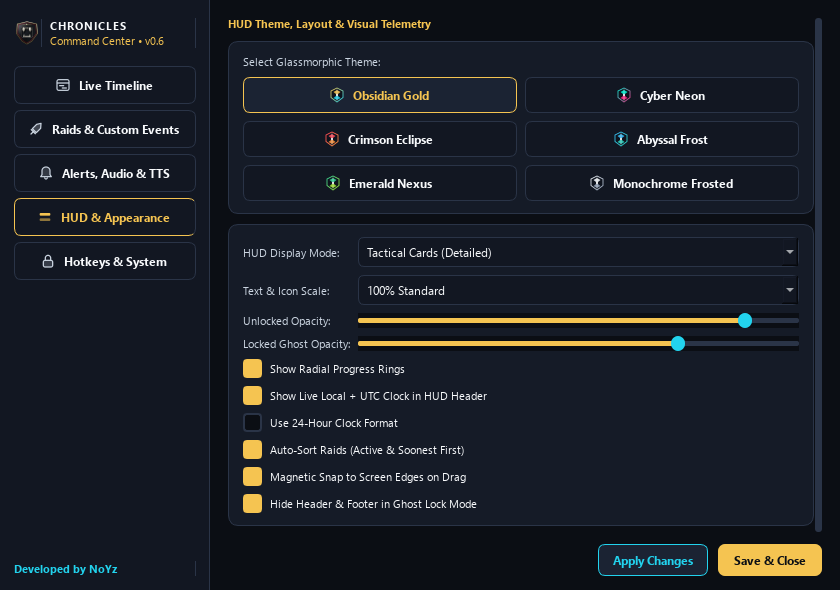
</div>
</details>

<details>
<summary><strong>5. Hook-Free Global Hotkeys, Tray & Backup System</strong></summary>
<br />
<div align="center">
  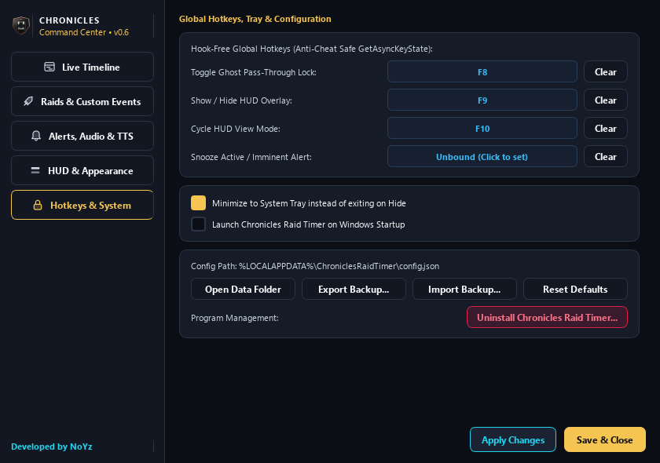
</div>
</details>

---

### Focus-Safe On-Screen Toast Alerts

Non-activating animated corner banners (`WindowDoesNotAcceptFocus`) notify you of upcoming raids or phase transitions without ever stealing focus from your game:

<div align="center">
  
</div>

---

### Windows Setup & Uninstaller Wizards

A modern 4-step per-user installer and clean uninstaller integrated directly with Windows Installed Apps and Start Menu:

| Setup Wizard *(4-Step Installer)* | Uninstaller Wizard |
| :---: | :---: |
| 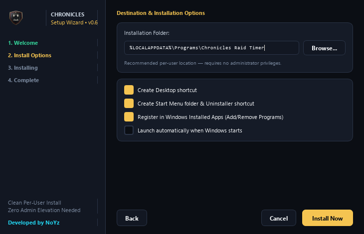 | 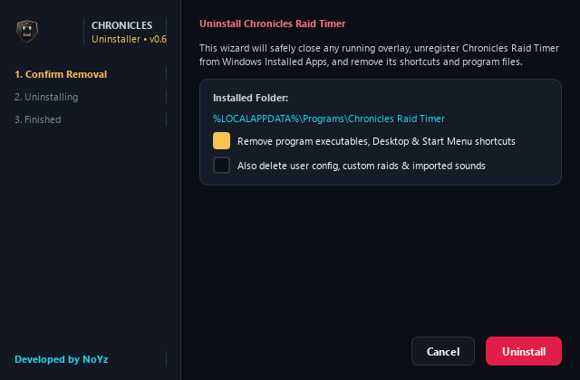 |

---

## Complete Feature Breakdown

### Tactical HUD Overlay
- **Custom-Painted Radial Progress Rings**: Shows cycle approach progress before start and remaining-time drain while active, with subtle pulse glows during live or imminent (`SOON`) windows.
- **Ghost Pass-Through Lock (`WS_EX_TRANSPARENT`)**: Enables true click-through transparency so mouse clicks pass cleanly to whatever application is beneath the HUD.
- **Independent Opacity Profiles**: Separate **Unlocked Opacity** (`45%–100%`) and **Locked Ghost Opacity** (`25%–100%`) sliders, plus an optional toggle to hide header and footer chrome while locked.
- **Live Local & UTC Clock**: Optional dual clock readout in the header (`12h` or `24h` format).
- **Auto-Priority Sorting**: Optionally keeps active (`LIVE`) and soonest upcoming events automatically sorted to the top.
- **Responsive Shrinking & Multi-Monitor Recovery**: Freely shrink the HUD down to a tight compact footprint (`~220 px` wide) with adaptive badge/label compression and zero text overlap, snap cleanly to screen edges, and automatically recover off-screen positions.

### Scheduling & Custom Event Engine
- **Built-In Automatic UTC Conversion**: Syncs all schedules cleanly to your system's local timezone.
- **Multi-Phase Support**: Tracks Phase 1 (`Normal`) and consecutive Phase 2 (`Hard`) transitions seamlessly.
- **Three Custom Timer Modes**:
  - **Daily UTC Schedule**: Multiple daily `HH:MM` UTC windows with configurable Phase 1 and Phase 2 durations and custom phase labels.
  - **Weekly UTC Schedule**: Day-of-week selector (`Mon`–`Sun`) paired with UTC times.
  - **Manual Boss Respawn Countdown**: Interval-based cooldown timer (`5`–`10080` minutes) with a **Start Respawn / Reset Timer** button right on the HUD card.
- **One-Click Quick Templates**: Instant presets for **Abyssal Clash** *(Weekly Sea Boss)* and **World Boss Respawn** *(4-hour manual respawn tracker)*.

### Five Curated Alert Audio Cues & Multi-Voice TTS
- **Multi-Stage Warning Milestones**: Arm any combination of `15 min`, `10 min`, `5 min`, `3 min`, `1 min`, and `At Start`, plus an independent toggle for **Phase 2 (Hard) transition alerts**.
- **Per-Cycle Snooze**: Mute notifications for an active or imminent raid cycle (`35 minutes`) directly from the card hover button or via global hotkey.
- **5 Curated 44.1 kHz HD WAV Cues** *(plus external `.wav`, `.mp3`, `.ogg`, `.flac`, `.m4a` import)*:
  - `Chronicles War Horn (Default)`
  - `Crystalline Chime`
  - `Tactical Radar Ping`
  - `Sanctuary Bell`
  - `Crimson Raid Alert`
- **Clean Multi-Voice Windows Announcer (TTS)**: Optional spoken callouts powered by `PyQt6.QtTextToSpeech` across **WinRT** and **SAPI** backends:
  - **3 Curated Announcer Personas** (`Commander David`, `Oracle Zira`, `Dispatch Mark`) plus deduplicated discovery of installed Windows System Voices.
  - **3 Callout Styles** (`Standard Callout`, `Brief Tactical`, `Epic Herald`) with natural **Voice Volume**, **Speech Rate**, and **Voice Pitch** sliders (`-40%` to `+40%`).

### Hotkeys, Tray & Reliability
- **Anti-Cheat Safe Polling**: Uses Win32 `GetAsyncKeyState` (`40 ms` polling) without low-level keyboard hooks (`WH_KEYBOARD_LL`), supporting single keys and modifier combinations (`Ctrl+F8`, `Alt+F9`, `Shift+...`).
- **System Tray Integration**: Minimize to tray, inspect the next scheduled raid from the tray tooltip, or control lock/visibility from the tray menu.
- **Single-Instance Guard & Atomic Config**: Native Windows mutex prevents duplicate windows; JSON configuration uses atomic replacement with **Export / Import Backup**, **Reset Defaults**, optional Windows Startup registration, and automatic portable mode (`portable.flag`).

---

## Built-In Raid Schedules

| Event | Normal Phase (`UTC`) | Normal Duration | Hard Phase (`UTC`) | Hard Duration |
|---|---|---|---|---|
| **Crimson Rift** | `03:00`, `11:00`, `19:00` | `30 minutes` | `03:30`, `11:30`, `19:30` | `30 minutes` |
| **Brutal Nightmare** | `04:00`, `12:00`, `20:00` | `60 minutes` | `05:00`, `13:00`, `21:00` | `60 minutes` |

---

## Default Controls & Hotkeys

| Action | Default Control / Key | Description |
|---|---|---|
| Toggle Ghost Pass-Through Lock | `F8` | Toggles click-through transparency and Ghost Lock state |
| Show / Hide HUD Overlay | `F9` | Shows or hides the HUD (minimizes to System Tray if enabled) |
| Cycle HUD Display Mode | `F10` | Switches between `Cards`, `Compact`, and `Horizontal` layouts |
| Snooze Active / Imminent Alert | *Unbound* *(Configurable)* | Snoozes alerts for the current active/imminent raid cycle (`35m`) |
| Move HUD | Left Click & Drag | Reposition anywhere on screen with optional magnetic edge snap |
| Resize HUD | Drag Right / Bottom Border or Corner | Resizes dimensions cleanly without text overlap |
| Quick Menu | Right Click *(Unlocked HUD)* | Access Command Center, View Mode, Lock, Audio Mute, Tray, Quit |

---

## Getting Started

### Option 1: Windows Installer *(Recommended)*
Run **`Chronicles_Raid_Timer_Setup_v0.6.exe`** (built in the isolated `Chronicles_Raid_Timer_Installer\` folder) on **Windows 10 / 11**:
- Clean **per-user installation** to `%LOCALAPPDATA%\Programs\Chronicles Raid Timer` (no administrator elevation required).
- Pure Win32 COM shortcut creation (`Desktop` and `Start Menu`) without spawning background shell scripts.
- Fast-launch uncompressed binary layout (`upx=False`) with embedded PE version metadata and `asInvoker` manifest.
- Native **Windows Installed Apps** registration (`Settings → Apps`) plus Start Menu and in-app **Uninstall Wizard** (`ChroniclesRaidTimer.exe --uninstall`, with `--silent` support).

### Option 2: Portable Executable
Launch `dist\ChroniclesRaidTimer.exe` directly on **Windows 10 / 11** — no installation or Python runtime required.

### Option 3: Run from Source

```powershell
# 1. Install dependencies
pip install -r requirements.txt

# 2. Generate curated sound cues & verify icons
python packaging/generate_assets.py

# 3. Launch Chronicles Raid Timer
python app.py
```

#### Configuration Paths
- **Source Run**: `./data/config.json` *(or custom path via `CHRONICLES_DATA_DIR`)*
- **Installed / Standalone EXE**: `%LOCALAPPDATA%\ChroniclesRaidTimer\config.json`
- **Portable Mode**: Place an empty `portable.flag` file beside `ChroniclesRaidTimer.exe` to store `config.json` and `custom_sounds/` in the same directory.

---

## Development, Testing & Packaging

```powershell
# Run full unit & offscreen UI smoke test suite (includes overlap checks)
python -m unittest discover -s tests -v

# Regenerate documentation screenshots
python packaging/capture_screenshots.py

# Build portable EXE + isolated Setup Installer EXE
.\packaging\build_release.ps1
```

Running `.\packaging\build_release.ps1` outputs:
- **Standalone Setup Installer**: `..\Chronicles_Raid_Timer_Installer\Chronicles_Raid_Timer_Setup_v0.6.exe`
- **Portable Single-File App**: `.\dist\ChroniclesRaidTimer.exe`

---

## Project Structure

```text
Chronicles_Raid_Timer/
├── app.py                              # Application controller, mutex guard, tray, alerts & --uninstall
├── version.py                          # Version metadata (APP_VERSION = "0.6")
├── requirements.txt                    # PyQt6, Pillow, numpy
├── chronicles/
│   ├── models.py                       # Raid definitions, windows, live statuses & templates
│   ├── schedule_engine.py              # UTC/Local/Weekly/Manual respawn & 24h timeline engine
│   ├── config.py                       # Atomic JSON config persistence, validation & portable mode
│   ├── themes.py                       # 6 glassmorphic color palettes
│   ├── audio_engine.py                 # 44.1 kHz WAV synthesizer, sound player & multi-voice TTS
│   ├── hotkey_manager.py               # Hook-free multi-action GetAsyncKeyState monitor
│   ├── win32_utils.py                  # DPI, click-through, COM shortcuts, registry & process control
│   └── ui/
│       ├── svg_icons.py                # 3D crest loader, SVG emblems & dynamic tinting
│       ├── widgets.py                  # ProgressRing, SvgIconButton, ColorSwatchButton, KeyCaptureButton
│       ├── raid_card.py                # TacticalRaidCard (Cards, Compact, Horizontal & adaptive narrow UI)
│       ├── hud_overlay.py              # Main glassmorphic floating HUD window
│       ├── timeline_widget.py          # Interactive 24-hour raid swimlane timeline canvas
│       ├── toast_banner.py             # Focus-safe animated corner notification banner
│       ├── command_center.py           # 5-tab Command Center & Custom Raid Editor modal
│       └── uninstaller_wizard.py       # Multi-step Uninstaller Wizard & silent uninstall helper
├── assets/
│   ├── icons/                          # Realistic 3D shield app_icon.png & multi-size app_icon.ico
│   └── sounds/                         # 5 curated HD .wav alert cues
├── docs/
│   ├── badges/                         # Self-hosted GitHub SVG badges (zero external CDN issues)
│   └── screenshots/                    # Showcase screenshots for GitHub README
├── packaging/
│   ├── app.manifest                    # Standard Windows asInvoker & Common Controls v6 manifest
│   ├── installer_wizard.py             # 4-step Chronicles Setup Wizard
│   ├── generate_assets.py              # Sound & icon verifier/generator
│   ├── capture_screenshots.py          # Automated UI screenshot generator
│   ├── ChroniclesRaidTimer.spec        # Portable single-file EXE spec (upx=False)
│   ├── ChroniclesAppPayload.spec       # Fast-launch onedir payload spec (upx=False)
│   ├── ChroniclesSetup.spec            # Standalone Setup Installer spec (upx=False)
│   ├── version_info.txt                # App PE version resource (0.6.0.0)
│   ├── version_info_setup.txt          # Setup PE version resource (0.6.0.0)
│   └── build_release.ps1               # End-to-end test, portable & installer build pipeline
└── tests/
    ├── test_schedule_engine.py         # Schedule & phase transition tests
    ├── test_config.py                  # Config persistence, TTS & hotkey parsing tests
    └── test_ui_smoke.py                # Offscreen PyQt6 rendering, overlap & wizard smoke tests
```

---

## Community & Updates

All future updates, patch notes, new features, and announcements are posted on the official Discord server:

- **Discord Server**: https://discord.gg/Vthdw8FYt6

---

## Changelog

### `v0.6` — Installer Hardening, Responsive HUD & Curated Audio
- Bumped release to **`v0.6`** across application telemetry, HUD/Command Center chrome, PE version metadata, and installer/uninstaller wizards.
- Re-engineered HUD chrome & card layout sizing with pixel-budget measurement and adaptive compact badges so windows shrink cleanly down to `~220 px` with zero label overlap.
- Curated **5 HD alert audio cues** featuring **Chronicles War Horn (Default)** and a **3-persona** Windows TTS announcer (`Commander David`, `Oracle Zira`, `Dispatch Mark`).
- Upgraded the emblem to a 3D heraldic crimson-and-gold shield icon (`app_icon.png` / `.ico`).
- Added a 4-step **Setup Wizard** (`Chronicles_Raid_Timer_Setup_v0.6.exe`) and 3-step/silent **Uninstaller Wizard** with `upx=False`, `asInvoker` manifest, `--onedir` payload, and pure Win32 COM shortcuts.

### `v0.1.0` — Initial Release
- Ground-up modular architecture for **Chronicles Raid Timer**.
- Glassmorphic floating HUD overlay with radial progress rings, 3 view modes (`Cards`, `Compact`, `Horizontal`), Ghost Pass-Through Lock, and magnetic edge snapping.
- 5-tab **Chronicles Command Center** with a 24-hour interactive timeline, custom Daily/Weekly/Manual respawn builder, multi-stage warning milestones, multi-voice Windows TTS announcer, focus-safe toast banners, 6 themes, and 5 curated HD audio cues.

---

## License

MIT License — Created by **NoYz**.
